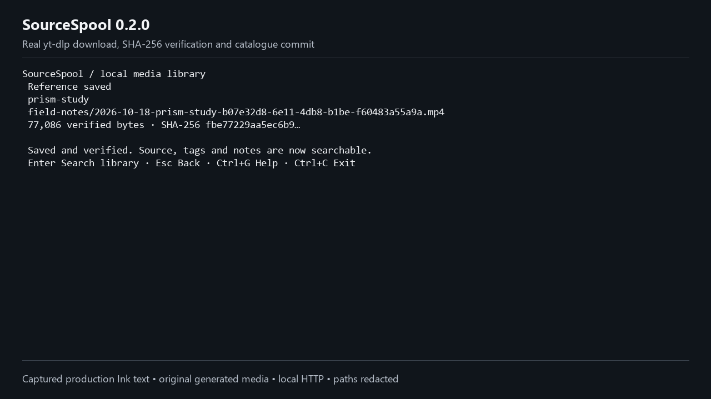

# SourceSpool

A Windows terminal library for saving permitted media references, keeping their source and context, and finding them again.

Released: [v0.1.0](https://github.com/JustinReyes28/sourcespool/releases/tag/v0.1.0) · source archive about 0.62 MB.

Real downloading, saved collections, tags, notes, search, naming templates, duplicate choices and metadata import/export are implemented. The original synthetic design demo remains separate.

[30-second workflow](docs/demo/sourcespool-demo.mp4) · [Capture details](docs/demo/README.md) · [Posting captions and images](docs/launch-kit/README.md) · [Release downloads and checksums](https://github.com/JustinReyes28/sourcespool/releases) · [Validation evidence](docs/validation-phase-3-4.md)

## Install and start

Supported: **Windows 11 x64, local NTFS storage, Node 24.19.0 (Node 24)**. Node 25 and other platforms are outside the tested support range. This release is a source archive, not a standalone installer.

1. Install [Node 24](https://nodejs.org/en/download) and extract a source release, or clone [this repository](https://github.com/JustinReyes28/sourcespool).
2. In PowerShell, run:

~~~powershell
npm ci
npm run build
~~~

3. Install **yt-dlp 2026.08.19** and **FFmpeg 9.0.2 Essentials** yourself, or explicitly run the optional helper:

~~~powershell
npm run tools:install
~~~

The helper downloads Windows binaries from the upstream hosts, verifies their published SHA-256 values and extracts them into .tools. It is never called by application startup or npm install. It downloads about 126 MB; installed tools occupy more disk space. The tools retain their own licenses and are not bundled in SourceSpool's source archive. [Versions and provenance](docs/tool-provenance.md).

4. Start with the helper's paths:

~~~powershell
node dist/cli.js --yt-dlp ".tools/yt-dlp.exe" --ffmpeg ".tools/ffmpeg-9.0.2-essentials_build/bin/ffmpeg.exe" --remember
~~~

First run asks you to choose and confirm a writable local library folder. Later, **npm start** uses the remembered location. To choose an explicit folder:

~~~powershell
node dist/cli.js --library "C:/Media/SourceSpool" --yt-dlp "C:/Tools/yt-dlp.exe" --ffmpeg "C:/Tools/ffmpeg/bin/ffmpeg.exe"
~~~

The --library option explicitly creates/opens that folder. Add --remember to save it for later sessions. Settings live at %LOCALAPPDATA%/SourceSpool/settings.json. SOURCESPOOL_YTDLP and SOURCESPOOL_FFMPEG are also supported. Run **node dist/cli.js --check-tools** with the same tool flags to check dependencies without library writes.

## Use the library

- **A** adds one public URL. Read metadata, choose a video or audio format with ↑/↓, and press Enter.
- Add comma-separated tags and a note. **Tab** changes field; **Ctrl+K** changes collection. Review the same filename template used for the save, then press Enter.
- Exact source/format matches warn before downloading. Matching completed-file SHA-256 hashes prompt after verification. **K** keeps the existing reference; **N** saves another. Existing media is never overwritten.
- **L** searches titles, URLs, tags and notes offline; all terms must match. ↑/↓ and Enter open details. **O** opens a verified media file; **U** opens its validated source.
- **C** creates a collection. **S** edits its persistent naming template. Tokens: {collection}, {date} (UTC), {title}, {id}, {ext}. End with .{ext}. Collisions receive a numeric suffix.
- **E** exports metadata to a new JSON file. **I** previews additions, conflicts and missing media before you choose which metadata wins. Exports do not contain media; back up the folders separately.
- **R** inspects interrupted commits and writer locks. Recover a verified item or keep its file unlisted. A stale lock is removed only on an explicit action after its owner is confirmed not running.

**Esc** goes back or cancels while retaining the session draft. **Ctrl+C** stops work and exits after the child process or commit settles. Cancellation during commit reports the actual saved/recovery outcome. **Q** exits from Home; **Ctrl+G** opens help. Fields support ←/→, Home/End, Backspace, Delete, paste and **Ctrl+U** to clear. **PgUp/PgDn** scrolls long review/details/help screens; the editing field follows its cursor. Very short terminals show resize guidance; at least 35 columns × 18 rows is required.

## Data, recovery and limits

The library contains catalogue.json, its last valid backup, collection folders, per-job staging and recovery journals. A completed record is stored only after nonempty media is hashed and the final file is observed. JSON updates use a single writer lock, revision checks, flushed temporary files and same-volume replacement. Use Recover before manually changing a lock or pending journal. [Storage contract](docs/architecture.md).

Missing media keeps its source and metadata. Restore it at the expected relative path; verified relinking is deferred. Source URLs can be private, so review an export before sharing it. The app uploads no catalogue, media, credentials or cookies.

Version 0.1.0 excludes playlists, authenticated/cookie sources, cloud sync, accounts, transcripts, automatic tool updates, npm publication and non-Windows support. Network shares and cloud-synced folders are untested. File opening is limited to common audio/video extensions and rechecks the stored hash. Public-source availability depends on yt-dlp and the site; recorded real-media checks use original locally served fixtures. Human research status and the approved solo-release gate are documented in [validation](docs/validation-phase-3-4.md). No screen-reader compatibility claim is made from keyboard tests alone.

## Develop and verify

~~~powershell
npm run check
$env:SOURCESPOOL_YTDLP = (Resolve-Path ".tools/yt-dlp.exe").Path
$env:SOURCESPOOL_FFMPEG = (Resolve-Path ".tools/ffmpeg-9.0.2-essentials_build/bin/ffmpeg.exe").Path
npm run test:integration
~~~

The check command typechecks source/scripts/tests, runs behavioral and keyboard tests, builds the CLI, and regenerates the separate synthetic design gallery. Integration tests require explicitly installed tools. They generate original video/audio, download it over loopback HTTP, exercise FFmpeg merging, stop a real Windows process tree, and forcibly interrupt a writer before recovery. Windows CI runs both suites.

[Production measurements](docs/production-baseline.json) distinguish first paint, tool readiness, JSON I/O, search and installed footprint. The original phase 2 baseline remains a dated, narrower measurement.

Production boundaries: terminal views → application controller/coordinator → domain validation/naming → local-library/downloader/opener adapters. UI code performs no process spawning or filesystem writes. The simulator and original 16 design sketches are retained as design references; run **npm run demo** or **node dist/cli.js --snapshot home**.

## Plans and credits

[Product](PLAN-01-Product-and-Differentiation.md) · [Design](PLAN-02-Design-Architecture-and-GitHub.md) · [Build](PLAN-03-Build-and-Improve.md) · [Validate/release](PLAN-04-Validation-and-GitHub-Release.md) · [Posting kit](PLAN-05-Marketing-and-Maintenance.md) · [Execution evidence](docs/execution-status.md)

[Yoinks](https://github.com/pablostanley/yoinks) by Pablo Stanley inspired the approachable terminal downloader concept. SourceSpool's code, collection workflow, copy, captures and sample media are original; no Yoinks source/assets were copied. [Comparison and provenance](docs/research/comparison-and-provenance.md).

Original application code is [MIT licensed](LICENSE). React/Ink and all external tools keep their own licenses. [Contributing](CONTRIBUTING.md).
